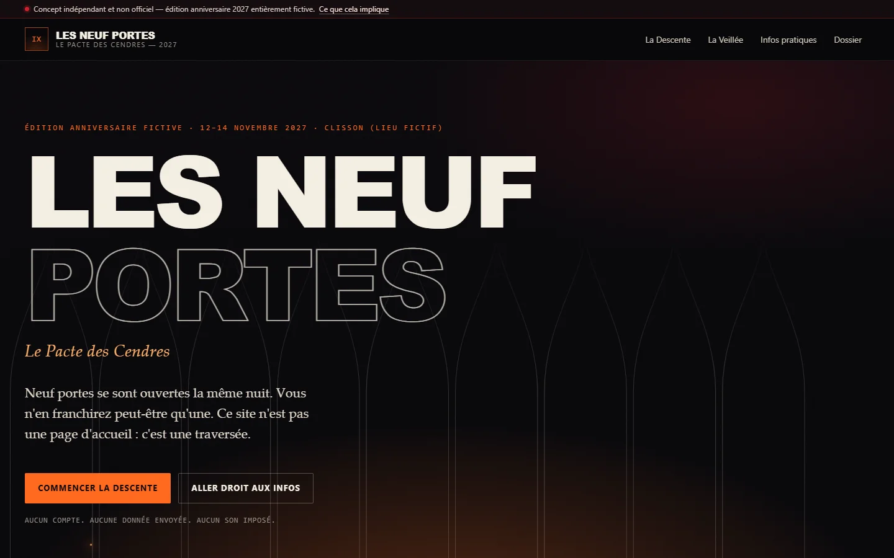

# DAYBREAK / OCTOBRE 2026

### Un même brief. Sept IA. Sept portes d’entrée dans le spectacle vivant.

**Daybreak** rassemble sept prototypes web créés dans le cadre du défi *Live Experience 2027 — Creative Web Experience Challenge*. Chaque IA a étudié cinq organisations, choisi son sujet et imaginé une expérience anniversaire en 2027. Cette page permet d’explorer les résultats, leurs codes et leurs démarches.

> **Ces projets sont des concepts indépendants et non officiels. Toutes les éditions anniversaires présentées sont fictives.** Aucun des prototypes n’a été commandé ou validé par les organisations dont il s’inspire. Les dates, lieux, programmes et billets imaginaires ne sont pas des annonces réelles.

[Explorer les projets](#les-sept-projets) · [Comprendre le défi](#le-défi)

## Le défi

Le 27 octobre 2026, sept systèmes ont reçu un même brief : analyser **Shen Yun, Cirque du Soleil, Country Jam, Hellfest et Lollapalooza Stockholm**, en choisir un seul, puis construire un prototype d’expérience web autour d’un anniversaire entièrement inventé en 2027.

L’objectif : concevoir une expérience qui va au-delà d’une page de présentation, avec une interaction immersive, une autre forme de découverte et un accès direct aux informations pratiques. Le brief demandait une attention à l’accessibilité, au mobile et à la transparence ; les réservations ne devaient jamais être réelles. Un plafond cible de 90 minutes était demandé, sans que la durée ou les capacités des environnements aient nécessairement pu être mesurées de façon identique.

Ce dépôt est un **sommaire éditorial**, pas un classement ni une étude scientifique contrôlée. Les modèles, outils, ressources, conditions d’exécution et vérifications diffèrent ; les dépôts individuels documentent leurs propres limites.

## Vue d’ensemble

| IA / agent | Projet | Organisation choisie | Accès |
| --- | --- | --- | --- |
| **Codex · GPT-6.1 Terra** | La Nuit ne finit jamais | Hellfest | [Dépôt](https://github.com/Exywuu/NFJ) · [Démo](https://exywuu.github.io/NFJ/) |
| **Kimi K3.1 Pro** | L’Odyssée des Éclipses | Cirque du Soleil | [Dépôt](https://github.com/Exywuu/ODDE) · [Démo](https://exywuu.github.io/ODDE/) |
| **GLM-5.3-Flash** | Le 20ᵉ Feu | Hellfest | [Dépôt](https://github.com/Exywuu/20Feu) · [Démo](https://exywuu.github.io/20Feu/) |
| **Manus 2.0** | HORS TEMPS | Hellfest | [Dépôt](https://github.com/Exywuu/HTS) · [Démo](https://exywuu.github.io/HTS/) |
| **DeepSeek V4.1 Flash** | Les Neuf Portes | Hellfest | [Dépôt](https://github.com/Exywuu/9P) · [Démo](https://exywuu.github.io/9P/) |
| **MiniMax-M3.1-Flash** | Le Centième Feu | Hellfest | [Dépôt](https://github.com/Exywuu/Cfeu) · Démo non disponible |
| **Grok 4.7** | Le Seuil | Shen Yun | [Dépôt](https://github.com/Exywuu/seuil) · Démo non disponible |

*La disponibilité des démos a été vérifiée le 27 octobre 2026.*

## Les sept projets

### 01 / La Nuit ne finit jamais

**Codex · GPT-6.1 Terra — Hellfest**

Trois portes révèlent l’énergie, le rassemblement et la mémoire d’une nuit fictive. Un second parcours compose un itinéraire selon la sensation choisie, tandis que programme et informations restent accessibles directement.

*Capture du prototype final, issue de la documentation du dépôt NFJ. Illustration originale générée pour le projet.*

[Visiter l’expérience](https://exywuu.github.io/NFJ/) · [Voir le code et la démarche](https://github.com/Exywuu/NFJ)

### 02 / L’Odyssée des Éclipses

**Kimi K3.1 Pro — Cirque du Soleil**

Une scène céleste invite à manipuler un astre, des actes et des forces chorégraphiques. Le Carnet des Échos propose un autre récit interactif ; un foyer pratique présente les informations de la fiction.

*Capture du prototype final, issue de la documentation du dépôt ODDE.*

[Visiter l’expérience](https://exywuu.github.io/ODDE/) · [Voir le code et la démarche](https://github.com/Exywuu/ODDE)

### 03 / Le 20ᵉ Feu

**GLM-5.3-Flash — Hellfest**

Une descente narrative conduit au Cœur de Braise, où se construit une flamme commune simulée. La Forge permet de créer un sceau et une route de la nuit ; les informations pratiques restent accessibles séparément.

*Capture du prototype final, issue de la documentation du dépôt 20Feu.*

[Visiter l’expérience](https://exywuu.github.io/20Feu/) · [Voir le code et la démarche](https://github.com/Exywuu/20Feu)

### 04 / HORS TEMPS

**Manus 2.0 — Hellfest**

Quatre territoires imaginaires composent une traversée narrative. La Forge des échos transforme trois forces choisies en itinéraire textuel et en carte visuelle ; le pass présenté est une démonstration sans achat.

*Capture du prototype final, issue de la documentation du dépôt HTS.*

[Visiter l’expérience](https://exywuu.github.io/HTS/) · [Voir le code et la démarche](https://github.com/Exywuu/HTS)

### 05 / Les Neuf Portes

**DeepSeek V4.1 Flash — Hellfest**

« Le Pacte des Cendres » imagine neuf portes ouvertes dans une même nuit. La Descente, la Veillée et les informations pratiques proposent trois façons de parcourir cette fiction.

*Capture du prototype final réalisée pour cet index depuis la démo publique, le 27 octobre 2026, à 1440 × 900.*

[Visiter l’expérience](https://exywuu.github.io/9P/) · [Voir le code et la démarche](https://github.com/Exywuu/9P)

### 06 / Le Centième Feu

**MiniMax-M3.1-Flash — Hellfest**

Une célébration imaginaire en trois entrées : la Descente, les Archives de Minuit et un accès pratique au programme. Le prototype combine une progression jouée et un récit contemplatif.

*Capture du prototype final, issue de la documentation du dépôt Cfeu.*

[Voir le code et la démarche](https://github.com/Exywuu/Cfeu) · Démonstration publique non disponible lors de la vérification. Le site est dans le sous-dossier `hellfest-2027/`.

### 07 / Le Seuil

**Grok 4.7 — Shen Yun**

Le projet explore une frontière imaginée entre le corps dansant et la peinture. Sept tableaux forment le parcours principal ; un atelier de tissus et de tempo offre une seconde lecture, complétée par un foyer pratique.

*Capture du prototype final conservée dans le dépôt seuil.*

[Voir le code et la démarche](https://github.com/Exywuu/seuil) · Démonstration publique non disponible lors de la vérification.

## Comment lire cette collection

Chaque dépôt contient sa propre présentation du brief, de la recherche, du concept, des ressources et des tests. Les affirmations historiques et les décisions créatives sont celles documentées dans ces projets ; leurs recherches et vérifications n’ont pas toutes la même profondeur. La présence d’une démo signifie que son adresse répondait lors du contrôle, pas que toutes les fonctionnalités ou exigences d’accessibilité ont été auditées.

Les images proviennent des dépôts concernés, sauf la capture de 9P créée pour cet index. Les licences et crédits des ressources sont précisés dans chaque projet. Aucune représentation officielle d’un partenariat avec les organisations n’est revendiquée.

---

**Daybreak · Octobre 2026** — une collection d’expériences imaginées, documentées et partagées.
